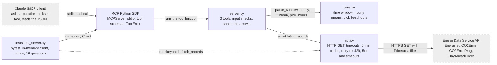

# energidata-mcp

[](https://github.com/batutho-dot/energidata-mcp/actions/workflows/tests.yml)

An MCP server that lets an AI assistant (Claude Code, Claude Desktop, any MCP host) look up
Danish electricity data from Energinet's open Energi Data Service: the CO2 intensity of the
power you use, the day-ahead spot price, and the cleanest or cheapest hours in a time window,
for price area DK1 (West Denmark) or DK2 (East Denmark).

## The question

Can a model answer "when is power cleanest or cheapest in Denmark?" correctly if it gets
three small, well-described tools instead of the raw API? Checked on 10 questions with
answers computed independently by a plain script.

**Score: 10 out of 10** (Claude Sonnet 5.5 through Claude Code 2.1.314, 2026-11-19), after one
fix to the server. Before the fix it was **9 out of 10**; the miss was the server's arithmetic,
not the model. Plain-script answers: 10 of 10 reproduced by the server tests.

## Run it (one command)

Needs Python 3.11 or newer and [uv](https://docs.astral.sh/uv/). From a clone of this repository:

```bash
uvx --from . energidata-mcp
```

That builds a fresh environment and starts the server on stdio (it then waits silently for
a host to talk to it). To add it to Claude Code:

```bash
claude mcp add energidata -- uvx --from /absolute/path/to/energidata-mcp energidata-mcp
```

Or with pip: `pip install .` then the command `energidata-mcp`.

## Example

Asked "when is the cheapest 3-hour block in DK1 on 17 November 2026?", the model calls
`best_hours(area="DK1", metric="price", start="2026-11-17", n_hours=3, consecutive=True)`
and gets (shortened):

```json
{
  "area": "DK1", "metric": "price", "unit": "DKK/MWh", "consecutive": true,
  "picked": [
    {"hour_dk": "2026-11-17T21:00", "value": 1361.03, "samples": 4},
    {"hour_dk": "2026-11-17T22:00", "value": 1280.32, "samples": 4},
    {"hour_dk": "2026-11-17T23:00", "value": 1125.38, "samples": 4}
  ],
  "mean_of_picked": 1255.58, "mean_of_window": 1563.5, "hours_in_window": 24
}
```

It answers "21:00 to 00:00, mean 1255.58 DKK/MWh", which matches the plain-script answer
(question 7 below).

## Tests

```bash
pip install -e ".[dev]"
pytest            # 48 tests, offline: the API is never called
python verify.py  # compile, tests, answer script, and the installed server over stdio
```

The tests cover the 10 eval questions through an in-memory MCP client, the error paths a
model can hit (bad date, empty or too-long window, unknown area, too many hours, API down),
the time and averaging functions (including the daylight-saving hour that happens twice),
and the HTTP client against a mock transport (rate limit, timeouts, HTTP 5xx, malformed
answers). GitHub Actions runs them on every push on Linux (Python 3.11 and 3.13) and Windows.

## How it works

An MCP server is a small program that an AI app starts in the background and talks to over
stdin and stdout. The server announces its tools (name, description, typed arguments); the
model decides when to call one, the app runs the call, and the result goes back to the model
as text plus structured JSON. The server never talks to the model directly.

This one has three files:

| File | Job |
|---|---|
| `src/energidata_mcp/api.py` | Fetches rows from the Energi Data Service API with a 30 s timeout, caches them for 5 minutes, waits and retries once on a rate-limit answer (HTTP 429), retries twice on a timeout or HTTP 5xx |
| `src/energidata_mcp/core.py` | Pure functions: checks the time window, averages 5-minute or 15-minute rows into hours, picks the lowest or highest hours |
| `src/energidata_mcp/server.py` | The three tools, built with the official [MCP Python SDK](https://py.sdk.modelcontextprotocol.io/) (`MCPServer`, v2.3) |

The tools:

| Tool | Answers | Dataset |
|---|---|---|
| `co2_intensity(area, start, end, source)` | g CO2/kWh per hour | `CO2Emis` (measured) or `CO2EmisProg` (forecast); `auto` picks measured for past windows |
| `spot_price(area, start, end, currency)` | DKK or EUR per MWh per hour | `DayAheadPrices` |
| `best_hours(area, metric, start, end, n_hours, consecutive, highest)` | the n cleanest or cheapest hours, or the best block of n back-to-back hours | as above |

All times in and out are Danish local time. A window is start (inclusive) to end (exclusive);
leave `end` out to get the rest of the start day. Wrong input (a bad date, an empty window)
comes back as a tool error the model can read and fix.

## How it is built

Claude talks to the server over stdio; the server asks Energinet's API for rows, averages
them into hours and answers. Boxes are the files, with keywords for what each one does.
The sequence of one request and a table linking each box to a file and line are in
[docs/architecture.md](docs/architecture.md).



## The test set

`eval/questions.json` holds 10 questions on two fixed past days (17 and 18 November 2026),
so the right answers do not move. `eval/answers.py` computes them straight from the API with
the standard library only, using its own grouping code (by the Danish-time hour string,
where the server groups by the UTC hour), so it checks the server's arithmetic rather than
repeating it.

```bash
python eval/answers.py        # writes eval/expected.json; downloads raw rows into eval/data/ if missing
pytest                        # the 10 questions through an in-memory MCP client, plus error paths
python eval/agent_run.py      # asks Claude Code each question, records answers and tool calls
python eval/score.py          # scores eval/agent_results.json against eval/expected.json
```

Data completeness for the test window: 576 of 576 five-minute CO2 rows and 192 of 192
fifteen-minute price rows per area.

## Results

Plain script (`eval/answers.py`, no model) and the agent, per question. The agent run used
`claude -p` with only this server's three tools enabled (no shell, web or files), one fresh
session per question. Rule set before the run: right when every required hour and number
appears in the answer (`eval/score.py`).

| # | Question (short) | Right answer (plain script) | Agent run 1 | Agent run 2 (after fix) | Tool calls |
|---|---|---|---|---|---|
| 1 | CO2 DK1, 17 Nov, 08:00 | 189.83 g/kWh | right | | `co2_intensity` |
| 2 | Cleanest hour DK2, 17 Nov | 01:00 (24.58 g/kWh) | right | | `best_hours` |
| 3 | Lower daily CO2, 18 Nov | DK1, 120.92 vs DK2 121.48 g/kWh | right | | `co2_intensity` x2 |
| 4 | Price DK1, 17 Nov, 18:00 | 1586.96 DKK/MWh | right | | `spot_price` |
| 5 | Cheapest hour DK2, 18 Nov | 04:00 (829.75 DKK/MWh) | right | | `best_hours` |
| 6 | Dearest hour DK1, 18 Nov | 18:00, 1574.96 DKK/MWh | right | | `best_hours` (highest) |
| 7 | Cheapest 3 h block DK1, 17 Nov | starts 21:00, mean 1255.58 DKK/MWh | right | | `best_hours` (consecutive) |
| 8 | Cleanest 3 h block DK2, 18 Nov | starts 08:00, mean 108.19 g/kWh | right (said mean 108.2) | right (108.19) | `best_hours` (consecutive) |
| 9 | 4 cheapest hours DK1, 18 Nov, 06 to 22 | 06:00, 11:00, 12:00, 13:00 | right | | `best_hours` |
| 10 | Day mean DK2, 17 Nov, EUR | 225.69 EUR/MWh | **wrong** (225.68) | right (225.69) | `spot_price` |

Every question took exactly 1 tool call, except question 3 (2 calls, one per area). The
model picked the right tool and arguments every time; it never needed a retry after a tool
error. Raw answers and calls: `eval/agent_results_run1.json` (run 1) and
`eval/agent_results.json` (run 1 with questions 8 and 10 replaced by run 2). The runs had
my own global Claude Code instructions loaded, which is why some answers end with "Next:" or
"Verified:" lines.

I also checked the extra numbers the model volunteered (day means, block hours) against the
plain script. All were right except one: in run 2, question 10 said the day's low was 187.98
at 04:00; the real low was 156.40 at 23:00 (run 1 had it right). The model read that off the
24 hourly values itself. A strict grader counting side claims would give run 2's question 10
a fail, which makes it 9 of 10 again.

## What did not work

- **My server rounded too early.** The first version rounded each hourly value to 2
  decimals and then averaged the rounded values. Day and block means came out 0.01 off on 2 of
  10 questions (225.68 instead of 225.69, 108.20 instead of 108.19). The agent repeated the
  tool's number faithfully, so run 1 lost question 10. My own tests did not catch it because
  they allowed a 0.01 tolerance. Fixed: means now use unrounded hourly values, and the tests
  demand an exact match (checked: the old code fails 2 of the tightened tests).
- **A side claim was wrong** even though the scored number was right (question 10, run 2,
  above). The tools return every hour, but nothing returns the minimum and maximum of a
  window, so the model scanned 24 numbers itself and picked the wrong one. A `min`/`max` field
  in the tool output would remove that step.
- **The rate limit dominates the waiting time.** The first draft of the answer script hit
  HTTP 429 twice and had to wait 62 seconds each time.
- **The SDK changed under older examples.** Older MCP examples use `FastMCP`; version 2
  of the official Python SDK uses `MCPServer`. This server was written from the current SDK
  docs, not from older examples.

## Limits

- **Rate limit.** The API allows very few uncached calls: after one call a dataset answered
  with the header `RemainingCalls: 0`, and the next call got HTTP 429 "Try again in N
  seconds" (about 60 seconds when measured). The server caches for 5 minutes and waits once,
  so a question that needs two areas can take a minute. It is not built for polling.
- **Hourly values are averages.** Prices are published per 15 minutes and CO2 per 5 minutes;
  every hourly value here is the plain mean of the rows in that hour. The day average is the
  mean of the hourly values.
- **Prices start 2025-10-01.** Older prices are in the discontinued `Elspotprices` dataset,
  which this server does not read.
- **CO2 data is initial data.** Energinet says the 5-minute CO2 series comes from upscaled
  real-time measurements and that errors "will generally not be corrected"; the corrected
  figures are in the `DeclarationGridEmission` dataset, not used here. The forecast tool path
  (`CO2EmisProg`) is not covered by the test set, because a forecast has no fixed answer.
- **Spot price only.** No taxes, tariffs or grid fees; this is not what a household pays.
- **"Now" is judged on the machine's clock** in Danish time, only to choose measured versus
  forecast CO2 when `source="auto"`.

## Data source and licence

Data: Energinet, [Energi Data Service](https://www.energidataservice.dk/), datasets
[CO2Emis](https://www.energidataservice.dk/tso-electricity/CO2Emis),
[CO2EmisProg](https://www.energidataservice.dk/tso-electricity/CO2EmisProg) and
[DayAheadPrices](https://www.energidataservice.dk/tso-electricity/DayAheadPrices).
Published under [CC BY 4.0](https://creativecommons.org/licenses/by/4.0/) per the
[terms and conditions](https://www.energidataservice.dk/terms-and-conditions).
Source: Energinet (www.energidataservice.dk). Changes made here: sub-hourly values are
averaged into hours. Energinet does not endorse this project. The raw rows for the two
test days (17 and 18 November 2026, DK1 and DK2) are stored unchanged in `eval/data/` so the
tests run offline; the computed answers are in `eval/expected.json`.

Code: MIT, see `LICENSE`.
