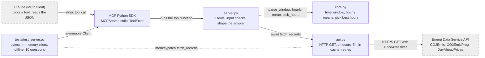
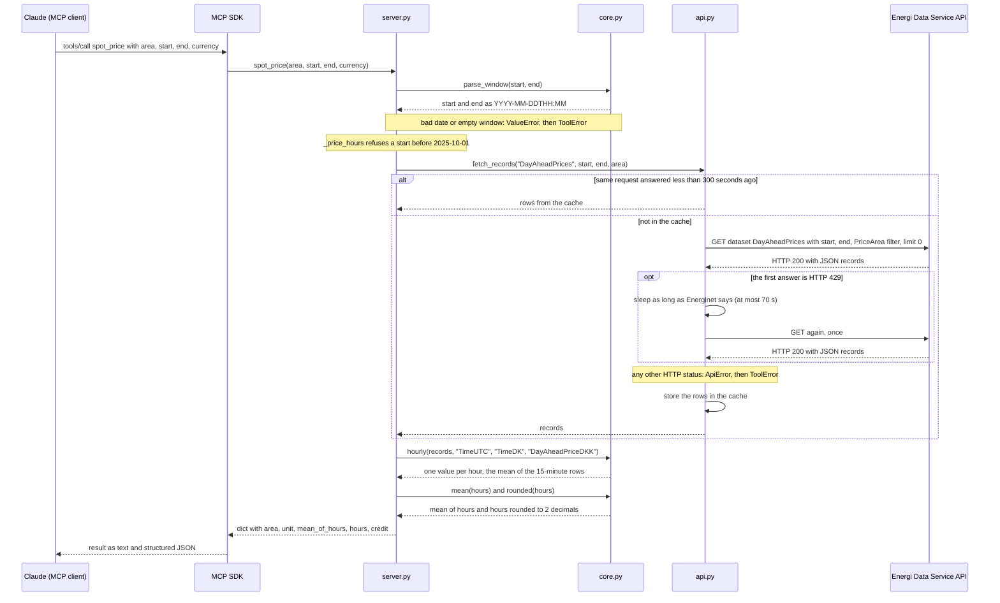

# Architecture

Line numbers point at the main function or class of each box.

## (a) Structure

Arrows read "uses". The dashed arrow is a test-only swap.

| Box | File | Main function or class | What it does |
|---|---|---|---|
| Claude (MCP client) | outside this repository | n/a | Starts the server and decides which tool to call. |
| MCP Python SDK | `src/energidata_mcp/server.py:17` | `mcp = MCPServer("energidata", ...)` | Speaks the protocol over stdin and stdout, turns `ToolError` into an error the model can read. |
| server.py | `src/energidata_mcp/server.py:63` | `co2_intensity` (also `spot_price` at :81, `best_hours` at :98, `main` at :135) | The three tools. Bad input becomes `ToolError`. |
| core.py | `src/energidata_mcp/core.py:40` | `hourly` (also `parse_window` at :12, `pick_hours` at :80) | Pure functions, no network: window check, hourly means, best hours. |
| api.py | `src/energidata_mcp/api.py:88` | `fetch_records` (retry loop `_get` at :60) | Fetches rows, caches 5 minutes, retries once on HTTP 429 and twice on a timeout or HTTP 5xx. |
| Energi Data Service API | `src/energidata_mcp/api.py:26` | `BASE_URL` | Energinet's open data service. |
| tests/test_server.py | `tests/test_server.py:38` | `client` fixture (offline swap at :28) | In-memory MCP client on rows saved in `eval/data/`, checked against `eval/expected.json`. |

## (b) One request: `spot_price`

"What was the spot price in DK1 on 17 November?" The other two tools differ only in dataset and what they do with the hours.

| Step | File | Line | What happens |
|---|---|---|---|
| Tool entry | `src/energidata_mcp/server.py` | `spot_price` at :81 | Receives the arguments. |
| Window check | `src/energidata_mcp/core.py` | `parse_window` at :12 | Accepts a date or date and time, defaults `end` to the next midnight, rejects windows over 31 days. |
| Price guard | `src/energidata_mcp/server.py` | `_price_hours` at :43 | Refuses starts before 2025-10-01, then fetches through `_fetch` at :50. |
| HTTP, cache, retry | `src/energidata_mcp/api.py` | `fetch_records` at :88 | Fresh cached rows, otherwise one GET with the retries above. |
| Parsing | `src/energidata_mcp/core.py` | `hourly` at :40 | Groups by UTC hour, so daylight saving stays correct. |
| Answer | `src/energidata_mcp/server.py` | `spot_price` at :81 | Adds the mean, the rounded hours and the credit line. |
