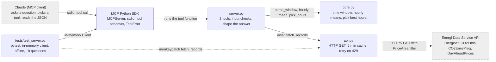
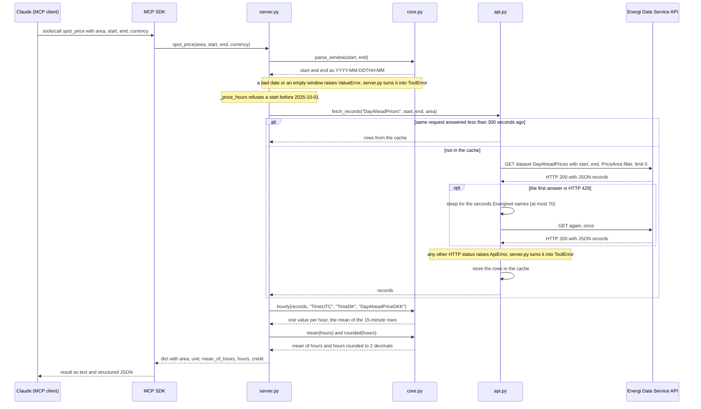

# Architecture

How `energidata-mcp` is put together, drawn from the code as it is. Line numbers point at
the main function or class of each box. Both diagrams render on GitHub.

## (a) Structure: who calls whom

Boxes are the files of the server plus the two things outside it: the MCP client (Claude)
and Energinet's API. Under each name are a few keywords for what the box does. An arrow
reads "uses". The dashed arrow is a test-only swap.

| Box | File | Main function or class | What it does |
|---|---|---|---|
| Claude (MCP client) | outside this repository | n/a | The AI app that starts the server, reads its tool list and decides which tool to call. |
| MCP Python SDK | `src/energidata_mcp/server.py:17` | `mcp = MCPServer("energidata", ...)` | The official library that speaks the protocol over stdin and stdout and turns Python errors of type `ToolError` into tool errors the model can read. |
| server.py | `src/energidata_mcp/server.py:63` | `co2_intensity` (also `spot_price` at :81, `best_hours` at :98, `main` at :135) | Defines the three tools, turns bad input into `ToolError`, and builds the JSON answer from the hours that `core.py` returns. |
| core.py | `src/energidata_mcp/core.py:40` | `hourly` (also `parse_window` at :12, `pick_hours` at :80) | Pure functions with no network: check the time window, average 5-minute or 15-minute rows into hours, pick the lowest or highest hours. |
| api.py | `src/energidata_mcp/api.py:47` | `fetch_records` | Fetches the rows for one dataset, window and price area, keeps them for 5 minutes, and waits and retries once on HTTP 429. |
| Energi Data Service API | `src/energidata_mcp/api.py:21` | `BASE_URL` | Energinet's open data service that holds the CO2 and price rows; it is not part of this repository. |
| tests/test_server.py | `tests/test_server.py:43` | `client` fixture (offline swap at :33) | Calls the tools through an in-memory MCP client, with the API call replaced by rows saved in `eval/.cache/`, and checks the 10 questions against `eval/expected.json`. |

Not drawn: `eval/` (the plain-script answer checker and the Claude Code agent run) and
`verify.py` are scripts around the server, not part of the path a request takes.

## (b) One request: `spot_price` from question to answer

The path of a single call, here "what was the spot price in DK1 on 17 November?". The other
two tools differ only in which dataset they read and what they do with the hours.

| Step | File | Line | What happens |
|---|---|---|---|
| Tool entry | `src/energidata_mcp/server.py` | `spot_price` at :81 | Receives the arguments the model chose. |
| Window check | `src/energidata_mcp/core.py` | `parse_window` at :12 | Accepts a date or date and time, defaults `end` to the next midnight, rejects windows over 31 days. |
| Price guard and fetch | `src/energidata_mcp/server.py` | `_price_hours` at :43 | Refuses starts before 2025-10-01, then calls the API client through `_fetch` at :50. |
| HTTP call, cache, retry | `src/energidata_mcp/api.py` | `fetch_records` at :47 | Returns cached rows if fresh, otherwise one GET, with one wait and retry on HTTP 429. |
| Parsing | `src/energidata_mcp/core.py` | `hourly` at :40 | Groups rows by UTC hour and averages them, so daylight saving changes stay correct. |
| Answer | `src/energidata_mcp/server.py` | `spot_price` at :81 | Adds the mean, the rounded hours and the credit line, and returns the dict. |
